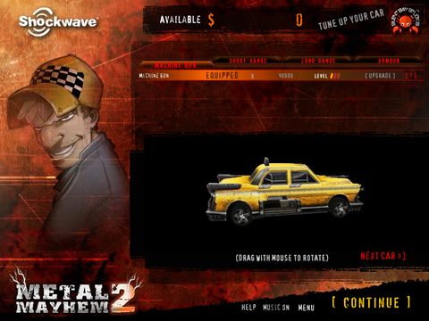
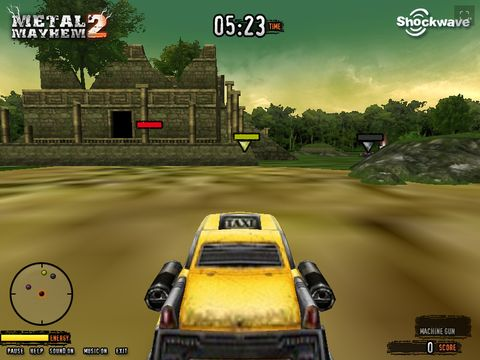
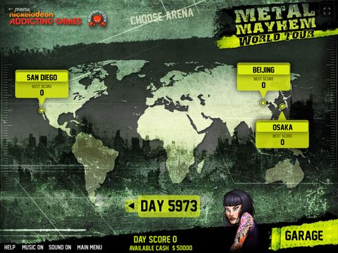

# shockwave-web

Play **Shockwave 3D games** (Macromedia Director movies with 3D, Havok physics and Flash menus) in a modern browser, with no plugin.

**Live demo:** [Metal Mayhem 2](https://play.bihari.xyz/metal-mayhem-2/) · [Metal Mayhem World Tour](https://play.bihari.xyz/metal-mayhem-world-tour/)

<table>
  <tr>
    <td></td>
    <td></td>
    <td></td>
  </tr>
</table>

## What this is

The official [dirplayer-rs](https://github.com/igorlira/dirplayer-rs) release (v0.8.1) can't run these games. Its 3D and Havok support is in an unmerged pull request, and the games call a Lingo method it doesn't have. This repo packages a build that works:

| Path | What |
|---|---|
| `dirplayer/` | Prebuilt player: dirplayer-rs [PR #244](https://github.com/igorlira/dirplayer-rs/pull/244), plus the [sewerrun-browser-port](https://github.com/Suleiman700/sewerrun-browser-port) fixes, plus a `_movie.systemDate()` fix that's new here. Source changes: `dirplayer/dirplayer-rs.patch` |
| `shockwave.js` | Loader: one script tag per game |
| `examples/` | Pages for the tested games |

**Game files are not included.** Bring your own copies.

## Tested games

| Game | Works |
|---|---|
| Metal Mayhem 2 | Menus, garage with 3D car preview, arena select, races |
| Metal Mayhem World Tour | Menus, garage with 3D car preview, world map, races load |

## Add a game

1. Get the game's files and its [Flashpoint](https://flashpointarchive.org) launch command. Metal Mayhem 2's is:
   ```
   "http://www.shockwave.com/content/metalmayhem2/sis/wrapper_silentbaystudios.dcr" --do "member('gameUrl').text = 'http://www.shockwave.com/content/metalmayhem2/sis/metal_mayhem2.dcr'"
   ```
2. Put the files under `content/<original host>/<original path>/` next to your page. **Keep the original host in the path.** Many games check `the moviePath` for their home domain, and Metal Mayhem only runs if it contains `shockwave.com`.
3. Copy `dirplayer/` and `shockwave.js` to your site, and add a page:
   ```html
   <script src="shockwave.js" data-dir="content/www.shockwave.com/content/metalmayhem2/sis/"
     data-launch='"{dir}wrapper_silentbaystudios.dcr" --do "member(&apos;gameUrl&apos;).text = &apos;{dir}metal_mayhem2.dcr&apos;"'
     data-width="800" data-height="600"></script>
   ```
   Replace the original URL prefix in the launch command with `{dir}`, and write `'` as `&apos;` inside the attribute.
4. Set `data-width` and `data-height` to the game's stage size. A box that's too small cuts off part of the screen. Metal Mayhem's menu buttons sit along the bottom of an 800×600 stage.
5. Serve the folder over HTTP(S). Opening the page from disk won't work.

## When a game won't start

dirplayer exposes its VM as `window.__vm`, so you can read the running game from the DevTools console:

```js
__vm.mcp_get_execution_state()                      // frame, stage size
__vm.mcp_eval_lingo("_movie.frame")                 // evaluate Lingo
__vm.mcp_get_globals()                              // the game's global variables
__vm.mcp_list_scripts(castLib, 100, 0)              // scripts in a cast
__vm.mcp_decompile_handler(castLib, member, "exitFrame")  // read a handler's Lingo
```

Reading the frame script the game is looping on usually shows what it's waiting for.

## Rebuild the player

See [`dirplayer/README.md`](dirplayer/README.md): check out the upstream commit, apply the patch, then `wasm-pack` and `vite`.

## Credits

- [dirplayer-rs](https://github.com/igorlira/dirplayer-rs) by Igor Lira and contributors, and its 3D/Havok work in PR #244 by chameleonxxl
- [sewerrun-browser-port](https://github.com/Suleiman700/sewerrun-browser-port) for the extra player fixes and for proving the approach
- [Ruffle](https://ruffle.rs) for the Flash menus
- [Flashpoint Archive](https://flashpointarchive.org) for the launch commands

## License

GPL-3.0, because the player is built from dirplayer-rs (GPL-3.0). The Ruffle files in `dirplayer/ruffle/` are MIT/Apache-2.0.

Not affiliated with Adobe, Macromedia, Havok, Shockwave.com, Miniclip, Silent Bay Studios or Nickelodeon. Game names and trademarks belong to their owners.
